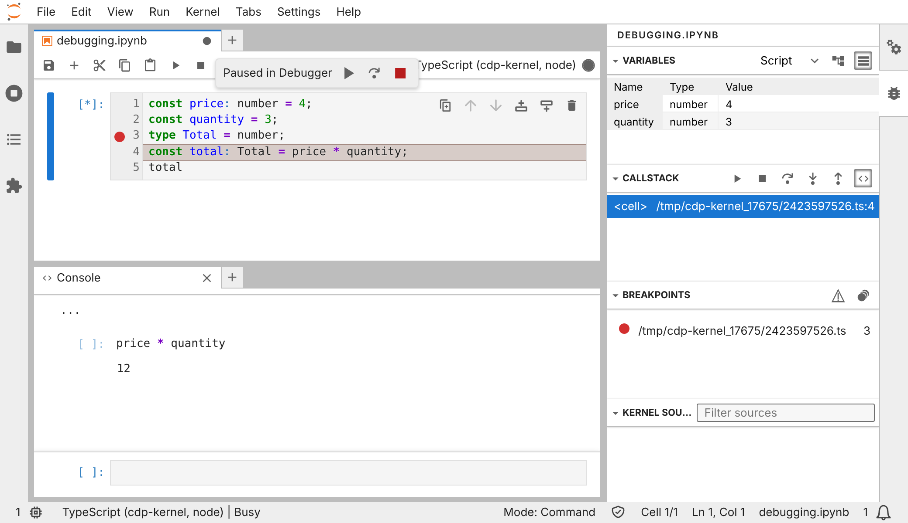

# Debugger

On Node and Deno kernels, JupyterLab's visual debugger works as it does
for Python. Bun, workerd and celld don't run over an inspector, so they
have no debugger.

This page is about JupyterLab (and Jupyter Notebook 7, which shares its
debugger), whether served by Jupyter or by
[Ganymede](https://ganymede-server.com/docs/install) with no Python.
VS Code's notebook debugging (Debug Cell, Run by Line) is documented for Python kernels and hasn't been tested with cdp-kernel.

## Using the debugger

1. Click the bug button in the notebook toolbar to turn debugging on. The
   debugger panel opens in the right sidebar.
2. Click in a cell's gutter, left of the line numbers, to set a
   breakpoint. Breakpoints are per line; a breakpoint on a blank or
   type-only line moves to the next statement.
3. Run the cell. Execution stops at the breakpoint, and the panel shows the
   call stack, the variables in each scope, and the source.
4. Step over, into or out of calls, or continue, from the panel's toolbar.
   Turn on pause on exceptions there to stop wherever an error is thrown.

While paused, the debug console evaluates expressions in the paused frame,
and the variable explorer can open a value in the rich viewer. Between
cells, the explorer lists the variables the cells have declared.

Lines refer to the TypeScript you wrote, even though the kernel compiles it
before running it.

If the bug button doesn't appear, the kernelspec predates debugger support:
re-run `cdp-kernel install` for that runtime.

Not supported: conditional breakpoints, logpoints, setting variables from
the debugger, and "copy to globals". See [Known gaps](known-gaps.md).

## A worked example

On a `cdp-node` notebook with the debugger on, take this cell:

```ts
const price: number = 4;
const quantity = 3;
type Total = number;
const total: Total = price * quantity;
total
```

Set a breakpoint on line 3, the `type` line, and run the cell. The type
has no code once compiled, so execution stops on line 4, the next
statement: the gutter keeps its dot on line 3, the editor highlights
line 4, and the call stack shows one frame, `<cell>`, at line 4 of the
cell's path (in the temp directory, such as
`/tmp/cdp-kernel_<pid>/<hash>.ts`).

The variables panel lists the cell's declarations under the Script scope.
`price` is 4 and `quantity` is 3; `total` isn't there yet, since line 4
hasn't run. The panel's tree view shows each variable's type, and its
table view (the button beside the scope menu) its value too.

Open the debug console with the call stack's Evaluate Code button (`<>`)
and enter `price * quantity`: it evaluates in the paused frame and
prints 12. JupyterLab empties the variables panel after each console
evaluation; click the frame in the call stack to show them again.



Continue from the panel's toolbar, and the cell finishes and shows 12.
`npm run docs:debugger` runs this example in JupyterLab and retakes the
screenshot.

## How it works

![JupyterLab sends setBreakpoints, and the kernel host sets the breakpoint with Debugger.setBreakpointByUrl on the cell's path, its line taken through the source map. The cell runs as a Runtime.evaluate ending in a sourceURL comment. V8's Debugger.paused reaches the host, which sends JupyterLab a stopped event on IOPub. While paused, stackTrace maps frame lines back to the cell, variables call Runtime.getProperties, the debug console's evaluate calls Debugger.evaluateOnCallFrame, and stepping maps to Debugger.resume and stepOver. An interrupt resumes a paused target first, then sends Runtime.terminateExecution on the control session.](images/integrations/debugger-flow.svg)

The kernel translates the Jupyter debug protocol (DAP over
`debug_request`) to V8's `Debugger` domain on the shell CDP session it
already holds (`src/debugger.ts`):

- **Cell paths.** Each cell is named as JupyterLab names it: a temp-dir
  prefix plus the Murmur2 hash of its code (`src/murmur2.ts`, matched
  against ipykernel's). It's evaluated with that name as its
  `//# sourceURL`, so breakpoints bind to the cell and frames point back at
  it.
- **Lines.** Breakpoint and frame lines go through the cell's source map
  (`src/sourcemap.ts`), since esbuild rewrites the TypeScript.
- **Nothing runs on its own.** The variable explorer between cells reads
  the cells' declarations with V8's side-effect check, so a getter never
  runs. Frames, scopes and the rich viewer evaluate on the paused frame.
- **Interrupts.** To interrupt a cell stopped at a breakpoint, the kernel
  resumes it first, since a paused isolate runs nothing to terminate, then
  sends
  `Runtime.terminateExecution` on the control session
  ([Interrupts](integration-cdp.md#interrupts)).
- **Kernelspec.** `metadata.debugger` is set for Node and Deno kernelspecs,
  which is what JupyterLab checks.

`CDPK_DEBUG_TRACE=1` logs every debug request, reply and event to the
Jupyter server's log. [Node and Deno](integration-cdp.md#the-debugger)
covers how this fits with the rest of the CDP integration.
