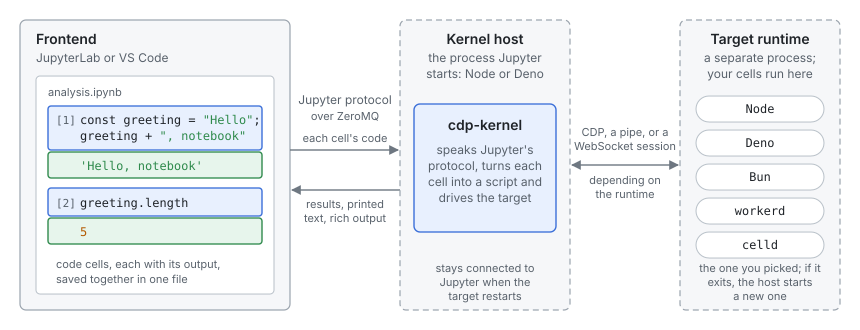

# Getting started

This page assumes you know some TypeScript or JavaScript, but nothing about
Jupyter or Deno. It covers what a notebook is, how to install cdp-kernel
and run a first notebook, and a few kinds of work it suits.

<!-- notebook: public/notebooks/getting-started.ipynb -->

## Notebooks and kernels

A Jupyter notebook is a file (`.ipynb`) made of **cells**. A code cell holds
a few lines of code; a Markdown cell holds prose. You run cells one at a
time, and each cell's output (a value, a table, a chart, printed text)
appears under it and is saved in the file. Variables, functions and imports
from one cell stay available to the cells you run after it, so you build a
program up a step at a time and look at the results as you go.

The program you open the notebook in, such as JupyterLab or VS Code, is the
**frontend**. It doesn't run your code itself. It sends each cell to a
**kernel**, a separate process for one language, and shows what comes back.
Jupyter started with Python, but kernels exist for many languages.



[Deno](https://deno.com), a JavaScript runtime, ships a kernel for
TypeScript (`deno jupyter`). cdp-kernel is that kernel taken out of Deno so
that notebook code can run on Node, Bun and other runtimes as well as Deno.
You don't need Deno installed, or any knowledge of it, to use cdp-kernel
with Node. Where Deno's notebook docs or blog posts show `Deno.jupyter`,
cdp-kernel offers the same API as a global named `jupyter`.

## Install

You need two things: a Jupyter frontend and the kernel.

**A frontend.** Either of these works:

- [JupyterLab](https://jupyter.org/install), the browser-based editor. It's
  a Python program; install it with `pipx install jupyterlab` or
  `uv tool install jupyterlab` (or `pip install jupyterlab` in a virtual
  environment). You don't write any Python.
- [VS Code](https://code.visualstudio.com/docs/datascience/jupyter-notebooks)
  with the Jupyter extension. VS Code still needs Jupyter's kernel
  registry, which the `cdp-kernel install` step below writes to.

**The kernel.** With Node 24 or later:

```sh
npm install -g @tlockney/cdp-kernel
cdp-kernel install --runtime node
```

`install` registers a kernel named `cdp-node`, shown in menus as
"TypeScript (cdp-kernel, node)". Check that Jupyter sees it:

```sh
jupyter kernelspec list
```

To run notebooks on Deno, Bun, workerd or celld instead, install a kernel
for each (`--runtime deno` and so on). [Install](install.md) covers those,
installing from JSR with Deno, and what each runtime needs. Linux and macOS
are supported; Windows isn't yet.

## Your first notebook

Start JupyterLab in the directory you want to work in:

```sh
mkdir scratch && cd scratch
jupyter lab
```

In the launcher, pick **TypeScript (cdp-kernel, node)** under Notebook. In
VS Code, create a file ending in `.ipynb`, click **Select Kernel**, and pick
the same name under Jupyter Kernels.

Type into the first cell and press **Shift-Enter** to run it:

```ts cell
const greeting: string = "Hello";
greeting + ", notebook"
```

The cell's last expression is shown as its result: `'Hello, notebook'`.
Then, in the next cell:

```ts cell
console.log(greeting.length);
await new Promise((resolve) => setTimeout(resolve, 500));
jupyter.md`**${greeting}** from a _Markdown_ result`
```

`greeting` is still defined, `console.log` prints under the cell, `await`
works at the top level, and `jupyter.md` renders Markdown instead of a
string. A few things worth knowing early:

- **Order matters, not position.** State comes from the cells you ran, in
  the order you ran them. The number beside a cell, like `[3]`, is its run
  order. If a notebook gets confusing, use **Kernel › Restart Kernel and
  Run All Cells** to rerun it from the top.
- **Imports work as in a module.** Import from `node:` builtins, from a
  `node_modules` next to the notebook, from local files (`./util.ts`), or
  straight from npm without an install step: `import { z } from
  "npm:zod@3"`. The package downloads on first use.
- **Interrupt** (the ■ button) stops a long cell and keeps your variables.
- **Shift-Tab** on a name shows what it is: its type, a function's
  signature, a preview of its value.
- **Rich output.** `jupyter.md`, `jupyter.html`, `jupyter.svg` and
  `jupyter.image` render their content, and `jupyter.display(...)` shows
  something without ending the cell. See [Writing notebooks](notebooks.md)
  for the full API.

Save the notebook and its outputs are saved with it, so someone opening it
later (or on GitHub) sees the results without running anything.

## What to use it for

A notebook is a good fit when you want to see intermediate results, keep a
record of what you did, or mix explanation with code. Some examples:

### Analysing data

Load a file once, then ask it questions cell by cell without reloading.
With `orders.csv` next to the notebook ([sample data](public/notebooks/orders.csv)):

```ts cell
import { readFile } from "node:fs/promises";

const [header, ...rows] = (await readFile("orders.csv", "utf8")).trim().split("\n");
const orders = rows.map((line) => {
  const [date, region, amount] = line.split(",");
  return { date, region, amount: Number(amount) };
});
orders.length
```

```ts cell
const byRegion = Object.groupBy(orders, (o) => o.region);
const totals = Object.entries(byRegion).map(([region, list]) => ({
  region,
  orders: list!.length,
  total: list!.reduce((sum, o) => sum + o.amount, 0),
}));
console.table(totals);
```

Each new question is a new cell that reuses `orders`. For larger data,
import a dataframe library such as `npm:nodejs-polars` or `npm:arquero`,
and draw charts with `npm:@observablehq/plot`. The
[MoMA collection notebook](../examples/moma-collection.ipynb) is a
worked example with both.

### Runbooks

A runbook is a procedure written down so anyone on a team can follow it:
check this, then do that. As a notebook, the explanation sits in Markdown
cells and each step is a cell you run, with its output kept as a record of
what happened.

```ts
const services = {
  api: "https://api.example.com/health",
  web: "https://www.example.com/health",
};

for (const [name, url] of Object.entries(services)) {
  const res = await fetch(url).catch((e) => e as Error);
  console.log(name, res instanceof Error ? `unreachable: ${res.message}` : res.status);
}
```

`prompt()` and `confirm()` ask the person running the notebook for input,
which suits steps that shouldn't run without a decision:

```ts
import { execFileSync } from "node:child_process";

if (confirm("Restart the worker queue?")) {
  console.log(execFileSync("systemctl", ["restart", "worker-queue"], { encoding: "utf8" }));
}
```

Save the notebook after a run and it doubles as the incident log.

### Exploring an API

When you're learning an HTTP API or a library, a notebook lets you make one
call, look at the response, and write the next call against what you saw.

```ts cell
const repo = await (await fetch("https://api.github.com/repos/tlockney/cdp-kernel")).json();
Object.keys(repo)
```

```ts cell
const { full_name, stargazers_count, open_issues_count, license } = repo;
({ full_name, stargazers_count, open_issues_count, license: license?.name })
```

The response stays in `repo`, so you don't call the API again for each
question. Press Shift-Tab on `repo` to see its properties, or on a library
function to see its signature before calling it.

### Experiments

Notebooks keep the code, the numbers and your notes together, which makes
them a good place for a quick measurement:

```ts cell
const data = Array.from({ length: 1_000_000 }, (_, i) => i);

function time(label: string, fn: () => unknown) {
  const start = performance.now();
  fn();
  console.log(label, (performance.now() - start).toFixed(1), "ms");
}

time("for loop", () => { let s = 0; for (let i = 0; i < data.length; i++) s += data[i]; return s; });
time("reduce", () => data.reduce((s, x) => s + x, 0));
```

cdp-kernel runs the same notebook on different runtimes. Install the
`deno` and `bun` kernels too, then switch with **Kernel › Change Kernel**
and rerun to compare. [Runtimes](runtimes.md) and
[Known gaps](known-gaps.md) list where the runtimes behave differently.

### Trying out syntax or a library

A notebook is a quicker place than a scratch project to check how a
language feature behaves or what a package does. Cells accept TypeScript,
with no `tsconfig.json` or build step:

```ts cell
type Point = { x: number; y: number };
const origin = { x: 0, y: 0 } satisfies Point;

enum Direction { Up = "UP", Down = "DOWN" }
[origin, Direction.Up, [3, 1, 2].toSorted()]
```

```ts cell
import { z } from "npm:zod@3";

const User = z.object({ name: z.string(), age: z.number().int() });
User.safeParse({ name: "Ada", age: 36.5 }).error?.issues
```

Cells aren't type-checked, as in Deno: types are removed and the code runs.
For type errors in your editor, see [Editor types](editor-types.md).

## Next steps

- [Writing notebooks](notebooks.md): the display API, imports, pinning
  package versions with a lockfile, and Deno projects.
- [Runtimes](runtimes.md): when to use Bun, workerd or celld, and how they
  differ.
- [Debugger](debugger.md): breakpoints in JupyterLab on Node and Deno.
- [Widgets and comms](widgets.md): interactive output.
- [Known gaps](known-gaps.md): what doesn't work yet.
