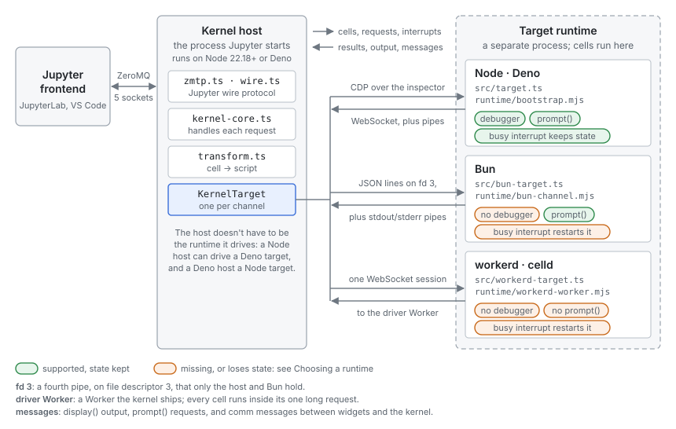

# Runtime integrations

cdp-kernel runs TypeScript notebooks on Node, Deno, Bun, workerd and celld.
This page explains how the kernel is split between the process Jupyter
talks to and the runtime that runs your cells, and what every runtime
integration has in common. The pages after it describe each integration in
detail:

- [Node and Deno](integration-cdp.md): driven over the Chrome DevTools
  Protocol (CDP).
- [Bun](integration-bun.md): a private pipe and an in-process evaluator.
- [workerd and celld](integration-workers.md): a driver Worker and one
  WebSocket session.

For what each runtime supports from a notebook's point of view, see
[Choosing a runtime](runtimes.md) and [Known gaps](known-gaps.md). For how a
cell's TypeScript becomes something a runtime can run, see
[Cells and module loading](architecture.md#cells-and-module-loading).

## Background: what a Jupyter kernel is

A Jupyter frontend (JupyterLab, VS Code, `nbclient`) doesn't run code
itself. It starts a separate *kernel* process, using the command in a
*kernelspec* (`kernel.json`), and hands it a connection file naming five
ZeroMQ sockets: shell (requests such as `execute_request` and
`complete_request`), iopub (output broadcast to every frontend), control
(interrupt and shutdown), stdin (`input_request` for `prompt()`), and a
heartbeat. Every message is a signed JSON envelope; this is the Jupyter
wire protocol.

`deno jupyter` is a kernel built into Deno: one process speaks the wire
protocol and evaluates cells in a V8 isolate it owns. cdp-kernel keeps
Deno's protocol code but splits it across two processes, so that the
runtime evaluating cells can be something other than Deno.

## Two processes: the host and the target

- **The kernel host** is the process Jupyter starts:
  `cdp-kernel kernel --runtime <name> --conn <file>` (`src/main.ts`). It
  runs on Node 24+ or Deno, whichever the package was installed with. It
  speaks ZMTP and the wire protocol itself (`src/zmtp.ts`, `src/wire.ts`;
  no libzmq), handles each request (`src/kernel.ts`), and turns cells into
  scripts (`src/transform.ts`).
- **The target** is the runtime your cells run in. The host starts it as a
  child process as soon as the host itself starts, and talks to it through a
  `KernelTarget` (below). The target loads a small set of runtime modules
  from `runtime/`: the `jupyter` display namespace, comms, widgets and
  introspection helpers, and a per-runtime entry point.

The host and the target can be different runtimes. A kernel installed from
npm has a Node host and can drive a Deno target, and the reverse.

Keeping the protocol in the host means the target only ever runs cell code
and a few helper calls. A target that crashes or is killed takes no Jupyter
state with it: the host reports the exit in the notebook and starts a new
target on the next cell.

## The KernelTarget interface

Every integration implements `KernelTarget` (`src/target.ts`). The kernel
calls nothing else, so this list is the complete contract:

| Member | What the kernel uses it for |
|---|---|
| `transform(code, options)` | Turns a cell into the script `evaluate` takes. Node and Deno use `transformCell`; the others use `transformCellForEval`. |
| `evaluate(script)` | Runs a cell. Resolves to a CDP-shaped `EvaluateResult`: a result, or exception details. Rejects with `Interrupted` after an interrupt. |
| `interrupt()` | Stops the running cell (see [Interrupts](#interrupts)). |
| `flush()` | Resolves once all output and display messages sent so far have been delivered, so `execute_reply` never overtakes a cell's output. |
| `broadcastResult(count, result)` | Formats a cell's value as `execute_result`, inside the target, where `[Symbol.for("Jupyter.display")]` and the other display hooks can run. |
| `describeError(exception)` | Name, message and stack of a thrown value, for the `error` message. |
| `dispatchComm(...)` | Hands a frontend comm message (widgets) to the target's comm handlers. |
| `propertyNames(expr)`, `lexicalNames()` | Tab completion. |
| `inspect(path, detail)` | Shift+Tab inspection, without running user code. |
| `debug` | The V8 `Debugger` domain, on Node and Deno only ([Debugger](debugger.md)). |
| `replyInput(value)` | The frontend's answer to an `input_request`. |
| `notice` | A line shown once, in the first cell, such as which project's bindings loaded. |
| `kill()` | Stops the target on shutdown or restart. |

The shapes are CDP's even for targets that don't speak CDP: a result is a
`RemoteObject` with an `objectId`, and an exception arrives as
`exceptionDetails`. On Bun, workerd and celld the `objectId` is a handle
(`h1`, `h2`, ...) into a map the target keeps, so the kernel handles every
target the same way.

## The three channels

Node and Deno expose V8's inspector, which speaks CDP. Driving a runtime
over CDP is what `deno jupyter` does to its own isolate, so that is the
default. Two kinds of runtime can't be driven that way:

- **Bun.** Its `--inspect` speaks the WebKit Inspector Protocol, which has
  no `replMode`, no `Runtime.addBinding` and no `Runtime.terminateExecution`.
- **workerd and celld.** Their inspector can evaluate code, but only
  outside a request, and outside a request a Worker has no I/O: timers,
  `fetch` and `crypto.randomUUID()` throw.

So each has its own channel, and cells run in-process instead of through
the inspector:

| | Node, Deno | Bun | workerd, celld |
|---|---|---|---|
| Channel | CDP over the inspector WebSocket | JSON lines on a pipe (fd 3) | One WebSocket session to a driver Worker |
| Cells run by | `Runtime.evaluate` with `replMode` | Indirect `eval` of global code | `UnsafeEval` (workerd) or `eval` (celld) of global code |
| Output | Pipes + CDP binding, ordered by barrier markers | Pipes + fd 3, ordered by barrier markers | All on the session, already in order |
| Imports resolved by | Node resolve hooks / Deno's loader | `bootstrap.mjs`, with `bun add` | The host, which bundles them with esbuild |
| Interrupt | `Runtime.terminateExecution`; state kept | Ping, else kill and restart | Ping, else kill and restart |
| `prompt()` | Yes, over stdin | Yes, over stdin | Returns `null` |
| Debugger | Yes | No | No |

## What every target shares

- **The `__cdpk` shim.** Each target installs a non-enumerable
  `globalThis.__cdpk` before any cell runs. Transformed cells call it
  (`__cdpk.import`, `__cdpk.meta`, `__cdpk.tick`), and the host calls it
  (`broadcastResult`, `describeError`, `commDispatch`, `barrier`). Node,
  Deno and Bun build it in `runtime/bootstrap.mjs`; workerd and celld in
  `runtime/workerd-worker.mjs`.
- **The display API.** `runtime/display.mjs` (a port of Deno's
  `40_jupyter.js`) provides the `jupyter` global, `display()`, MIME
  bundles and `prompt()`/`confirm()`. A target only supplies how to send a
  message, how to inspect a value and how to read input.
- **Object-literal wrapping.** A cell like `{ a: 1 }` is tried as
  `({ a: 1 })` first, as Deno's REPL does, and falls back to the code as
  written.
- **The first-cell notice.** Anything the user needs to know about the
  launch, such as a Deno or Workers project that failed to load, appears on
  stderr in the first cell, not only in the server log.

## Lifecycle

1. Jupyter starts the host with the connection file. The host binds the
   five sockets and launches the target right away, so the first cell
   doesn't wait for it. A `kernel_info_request` on the shell socket waits
   for the launch, so the reply can name the target's runtime and engine
   versions.
2. If the target doesn't come up, the failure goes to the server log, and
   the first cell tries again. If that also fails, the cell ends with a
   `KernelError` saying why.
3. If the target exits (a crash, or a busy interrupt on Bun, workerd or
   celld), the host prints why in the notebook and starts a new target on
   the next cell. Earlier cells' state is gone; Jupyter itself stays
   connected.
4. On `shutdown_request` the host kills the target and exits. Frontends
   start a fresh kernel even for a restart.

## Output ordering

A cell's output reaches the host by two routes: plain `stdout`/`stderr`
pipes (`console.log`, and anything a library writes), and messages
(`display()`, `prompt()`, comm messages) over the CDP binding or fd 3. The
two routes race, so on Node, Deno and Bun the target numbers every message
and writes a matching marker to both pipes first:

The markers are `ESC[cdpk:<n>m]ESC` sequences, which `PipeDemux` in
`src/target.ts` strips out. workerd and celld don't need them: there,
`console` writes into the same WebSocket as everything else.

## Interrupts

Jupyter interrupts with an `interrupt_request` on the control socket
(kernelspecs set `interrupt_mode: "message"`). How the host stops the cell
depends on the channel:

On Node and Deno, a cell starts with `await __cdpk.tick()`, one macrotask.
Without it, a busy loop would run inside the inspector's dispatch of
`Runtime.evaluate`, and the inspector processes no other message until
that dispatch returns, so the interrupt would never be read. After the
tick, the cell runs as an ordinary task and V8 can terminate it.

On the other targets there is no way to stop JavaScript that is running,
so a cell that is still computing costs the runtime and its state. A cell
that is only waiting (on a timer, `fetch`, a promise) is abandoned in place:
whatever it started keeps running, and its later output still appears.
