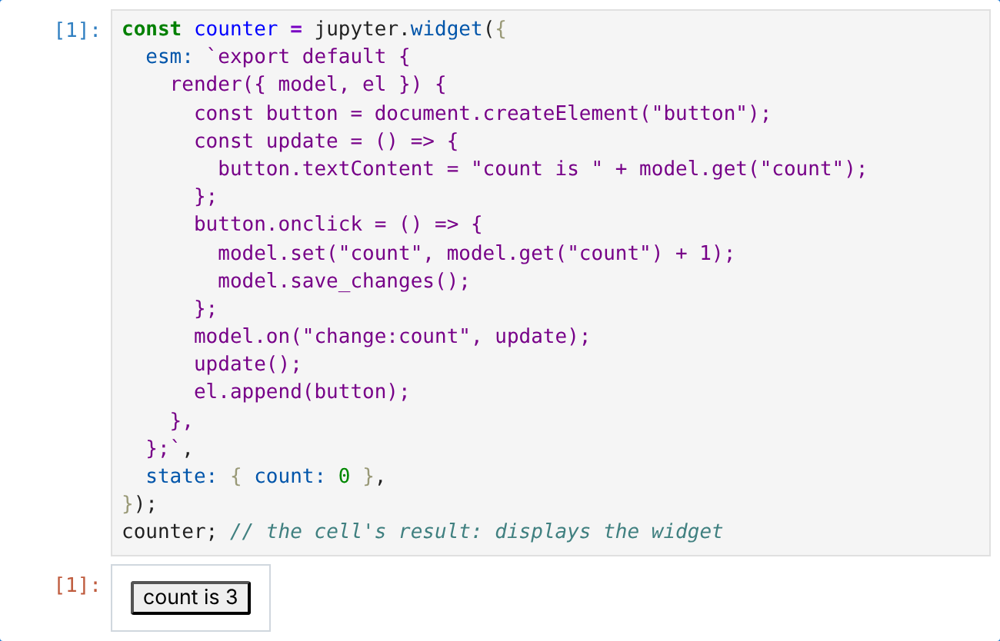

<!-- Generated by scripts/reference.ts from the doc comments in runtime/display.d.mts, runtime/host.d.mts, src/globals.ts. Edit those, then run `node scripts/reference.ts --write`. -->

# `jupyter` reference

Every member of the `jupyter` global and the `prompt` and `confirm`
globals, with their arguments, return values and an example. [The
`jupyter` namespace](jupyter-api.md) explains them with longer examples
and their output. Widgets and comms are in the [widgets
reference](widgets-reference.md).

| Member | What it does |
| --- | --- |
| [`jupyter.broadcast(msgType, content, options?)`](#jupyter-broadcast-msgtype-content-options) | Send a raw Jupyter message on the kernel's output channel (IOPub), as a reply to the running cell. |
| [`jupyter.display(obj, options?)`](#jupyter-display-obj-options) | Show a value now, in the middle of a cell, or replace one shown earlier. |
| [`jupyter.format(obj)`](#jupyter-format-obj) | The MIME bundle that displaying a value would send, without showing anything. |
| [`` jupyter.md`…` ``](#jupyter-md) | A tagged template that renders as Markdown. |
| [`` jupyter.html`…` ``](#jupyter-html) | A tagged template that renders as HTML. |
| [`` jupyter.svg`…` ``](#jupyter-svg) | A tagged template that renders as SVG. |
| [`jupyter.image(obj)`](#jupyter-image-obj) | Show a PNG or JPEG. |
| [`jupyter.$display`](#jupyter-display) | The symbol a class implements to choose how its instances appear. |
| [`jupyter.comm`](#jupyter-comm) | Jupyter comms: message channels to the frontend outside cell execution. |
| [`jupyter.widget(options)`](#jupyter-widget-options) | Create an anywidget-compatible widget model. |
| [`jupyter.signal`](#jupyter-signal) | An `AbortSignal` that an interrupt aborts, so code waiting on something only it can end can stop and clean up. |
| [`jupyter.params`](#jupyter-params) | The parameters of this run: a frozen object, empty unless whoever started the kernel passed some, such as `ganymede execute -p counter="2nd Ave"`. |
| [`jupyter.result(name, value)`](#jupyter-result-name-value) | Publish a value under a name, as an output that a run's caller reads by name instead of parsing outputs: `ganymede execute --results`, or another notebook. |
| [`jupyter.host(options?)`](#jupyter-host-options) | The Ganymede server running this kernel, through its host API: read, search and (when granted) run other notebooks under its root. |
| [`host.has(method)`](#host-has-method) | Whether this notebook may call `method`. |
| [`host.call(method, params?, options?)`](#host-call-method-params-options) | Call a method by name. |
| [`prompt(message?, defaultValue?, options?)`](#prompt-message-defaultvalue-options) | Ask for a line of input in the notebook: the frontend shows an input box under the cell, and the cell waits for the answer. |
| [`confirm(message?)`](#confirm-message) | Ask a yes/no question in the notebook. |

## `jupyter`

The `jupyter` global: how values appear in the notebook. The same object
as `Deno.jupyter` in `deno jupyter`.

### `jupyter.broadcast(msgType, content, options?)`

```ts
broadcast(
  msgType: string,
  content: object,
  options?: { metadata?: object; buffers?: Uint8Array[] },
): void;
```

Send a raw Jupyter message on the kernel's output channel (IOPub), as a
reply to the running cell. The other helpers are built on it. It does
not check the message: a wrong field is ignored or mishandled by the
frontend.

| Parameter | Type | Required | Description |
| --- | --- | --- | --- |
| `msgType` | `string` | yes | An IOPub message type, such as `"clear_output"` or `"display_data"`. |
| `content` | `object` | yes | The message content, as the messaging spec defines it for `msgType`. |
| `options` | `{ metadata?: object; buffers?: Uint8Array[] }` | no | `metadata` for the message, and binary `buffers`. |

```ts
// Count down in place: clear_output with wait avoids a flicker.
for (const n of [3, 2, 1]) {
  jupyter.broadcast("clear_output", { wait: true });
  await jupyter.display(jupyter.md`Launching in **${n}**…`);
  await new Promise((resolve) => setTimeout(resolve, 1000));
}
```

Guide: [The `jupyter` namespace](jupyter-api.md#raw-messages-with-broadcast)

### `jupyter.display(obj, options?)`

```ts
display(obj: unknown, options?: DisplayOptions): Promise<void>;
```

Show a value now, in the middle of a cell, or replace one shown
earlier. The value can be anything a cell could end with: a template
from `md`, `html` or `svg`, an image, a widget, an object with a
`[jupyter.$display]` method, or a plain value, shown as text.

| Parameter | Type | Required | Description |
| --- | --- | --- | --- |
| `obj` | `unknown` | yes | The value to show. |
| `options` | `DisplayOptions` | no | `display_id` and `update` to replace an earlier output; `raw` to send a plain object as the MIME bundle itself. |

**Returns** `Promise<void>`: Resolves once the output is sent. Without `await` the output still appears, but later output in the cell can appear before it.

```ts
const bar = (pct: number) => jupyter.html`<progress value="${pct}" max="100"></progress>`;
await jupyter.display(bar(0), { display_id: "download" });
for (let pct = 25; pct <= 100; pct += 25) {
  await new Promise((resolve) => setTimeout(resolve, 500));
  await jupyter.display(bar(pct), { display_id: "download", update: true });
}
```

```ts
// A MIME bundle sent as is: JupyterLab renders it as a JSON tree.
const user = { name: "Ada", active: true };
await jupyter.display(
  { "application/json": user, "text/plain": JSON.stringify(user) },
  { raw: true },
);
```

Guide: [The `jupyter` namespace](jupyter-api.md#showing-output-with-display)

### `jupyter.format(obj)`

```ts
format(obj: unknown): Promise<MediaBundle>;
```

The MIME bundle that displaying a value would send, without showing
anything. For plain values `text/plain` holds terminal color codes,
as the notebook shows them.

| Parameter | Type | Required | Description |
| --- | --- | --- | --- |
| `obj` | `unknown` | yes | The value to format. |

**Returns** `Promise<MediaBundle>`: The bundle, for example `{ "text/plain": "\x1b[33m42\x1b[39m" }` for `42`.

```ts
const bundle = await jupyter.format(jupyter.md`# Weekly report`);
bundle["text/markdown"]; // "# Weekly report"
```

Guide: [The `jupyter` namespace](jupyter-api.md#getting-a-bundle-with-format)

### `` jupyter.md`…` ``

```ts
md(strings: TemplateStringsArray, ...values: unknown[]): Displayable;
```

A tagged template that renders as Markdown. Interpolated values are
inserted as is, without escaping.

**Returns** `Displayable`: A value that shows as `text/markdown` as a cell's result or through `display`.

```ts
const scores = { Ada: 92, Grace: 88 };
const rows = Object.entries(scores).map(([n, s]) => `| ${n} | ${s} |`).join("\n");
jupyter.md`| Name | Score |
| --- | --- |
${rows}`;
```

Guide: [The `jupyter` namespace](jupyter-api.md#markdown)

### `` jupyter.html`…` ``

```ts
html(strings: TemplateStringsArray, ...values: unknown[]): Displayable;
```

A tagged template that renders as HTML. Interpolated values are
inserted as is, without escaping: escape text from users, files or
the network yourself.

**Returns** `Displayable`: A value that shows as `text/html`.

```ts
const escape = (s: string) => s.replace(/[&<>"']/g, (c) => `&#${c.charCodeAt(0)};`);
const comment = "<script>alert(1)</script>";
jupyter.html`<p>${escape(comment)}</p>`;
```

Guide: [The `jupyter` namespace](jupyter-api.md#html)

### `` jupyter.svg`…` ``

```ts
svg(strings: TemplateStringsArray, ...values: unknown[]): Displayable;
```

A tagged template that renders as SVG. Include the `xmlns` attribute.
Interpolated values are inserted as is, without escaping.

**Returns** `Displayable`: A value that shows as `image/svg+xml`.

```ts
const data = [4, 8, 15, 16];
const bars = data.map((v, i) => `<rect x="${i * 20}" y="${40 - v * 2}" width="16" height="${v * 2}"/>`).join("");
jupyter.svg`<svg xmlns="http://www.w3.org/2000/svg" width="80" height="40">${bars}</svg>`;
```

Guide: [The `jupyter` namespace](jupyter-api.md#svg)

### `jupyter.image(obj)`

```ts
image(obj: string | Uint8Array): Displayable;
```

Show a PNG or JPEG. The format is read from the bytes, not the file
name.

| Parameter | Type | Required | Description |
| --- | --- | --- | --- |
| `obj` | `string \| Uint8Array` | yes | A file path, relative to the notebook's directory, or the image's bytes. |

**Returns** `Displayable`: A value that shows as `image/png` or `image/jpeg`.

**Throws** `TypeError`: The bytes are not PNG or JPEG, or the path can't be read.

**Availability**: Paths need a file system: on workerd and celld pass bytes.

```ts
jupyter.image("./chart.png");
```

```ts
const response = await fetch("https://www.python.org/static/img/python-logo.png");
jupyter.image(new Uint8Array(await response.arrayBuffer()));
```

Guide: [The `jupyter` namespace](jupyter-api.md#images)

### `jupyter.$display`

```ts
$display: typeof $display;
```

The symbol a class implements to choose how its instances appear. The
method returns a MIME bundle, or a promise of one. It is used for a
cell's result, `display` and `format`, but not for objects nested in
other values. At runtime it is `Symbol.for("Jupyter.display")`.

```ts
class Temperature {
  celsius: number;
  constructor(celsius: number) {
    this.celsius = celsius;
  }
  [jupyter.$display]() {
    return { "text/plain": `${this.celsius}°C`, "text/html": `<b>${this.celsius}°C</b>` };
  }
}
new Temperature(21);
```

Guide: [The `jupyter` namespace](jupyter-api.md#custom-display-for-your-own-classes)

### `jupyter.comm`

```ts
comm: CommApi;
```

Jupyter comms: message channels to the frontend outside cell
execution. Its methods are in the widgets and comms reference.

Guide: [Widgets and comms](widgets.md#comms)

### `jupyter.widget(options)`

```ts
widget(options: WidgetOptions): Widget;
```

Create an anywidget-compatible widget model. Display it (or end the
cell with it) to show a view.

| Parameter | Type | Required | Description |
| --- | --- | --- | --- |
| `options` | `WidgetOptions` | yes | The view module, its CSS, and the initial state. |

**Returns** `Widget`: The model, synced with every view of it.

**Throws** `TypeError`: `options.esm` is not a string.

**Availability**: The frontend needs the anywidget extension.

```ts
const counter = jupyter.widget({
  esm: `export default {
    render({ model, el }) {
      const button = document.createElement("button");
      const update = () => {
        button.textContent = "count is " + model.get("count");
      };
      button.onclick = () => {
        model.set("count", model.get("count") + 1);
        model.save_changes();
      };
      model.on("change:count", update);
      update();
      el.append(button);
    },
  };`,
  state: { count: 0 },
});
counter; // the cell's result: displays the widget
```



Guide: [Widgets and comms](widgets.md#a-first-widget-a-counter)

### `jupyter.signal`

```ts
readonly signal: AbortSignal;
```

An `AbortSignal` that an interrupt aborts, so code waiting on something
only it can end can stop and clean up. Each cell gets its own, as does
a comm handler that starts while no cell runs. Read it once when the
work starts: a later read gets the signal of whatever started last.
The abort reason is a `DOMException` named `AbortError`.

```ts
const response = await fetch("https://example.com/large.csv", { signal: jupyter.signal });
```

```ts
const signal = jupyter.signal;
const ask = jupyter.comm.open("my.app", { question: "ready?" });
const answer = await new Promise((resolve, reject) => {
  ask.onMsg((m) => resolve(m.data));
  signal.addEventListener("abort", () => { ask.close(); reject(signal.reason); }, { once: true });
});
```

Guide: [The `jupyter` namespace](jupyter-api.md#stopping-on-interrupt-jupyter-signal)

### `jupyter.params`

```ts
readonly params: { readonly [name: string]: JsonValue };
```

The parameters of this run: a frozen object, empty unless whoever
started the kernel passed some, such as `ganymede execute -p
counter="2nd Ave"`. They arrive as a JSON object in the kernel's
`GANYMEDE_PARAMS` environment variable. Take defaults with
destructuring, so the notebook also runs on its own.

**Throws** `TypeError`: `GANYMEDE_PARAMS` is set but isn't a JSON object.

**Availability**: Node, Deno, Bun, workerd and celld read the kernel's environment; the browser target takes `params` from its options.

```ts
const { counter = "Fremont", days = 30 } = jupyter.params as { counter?: string; days?: number };
`${counter}, last ${days} days`;
```

Guide: [The `jupyter` namespace](jupyter-api.md#parameters-and-named-results)

### `jupyter.result(name, value)`

```ts
result(name: string, value: unknown): void;
```

Publish a value under a name, as an output that a run's caller reads
by name instead of parsing outputs: `ganymede execute --results`, or
another notebook. The output has the MIME type
`application/vnd.ganymede.result+json` holding `{ name, value }`, and
a `text/plain` line `name = value` for frontends that don't know the
type. When a name is published twice, readers take the last one.

| Parameter | Type | Required | Description |
| --- | --- | --- | --- |
| `name` | `string` | yes | The result's name. |
| `value` | `unknown` | yes | Any value `JSON.stringify` accepts; it is stored as JSON, so a `Date` becomes its ISO string. |

**Throws** `TypeError`: `name` is empty, or `value` isn't JSON (a function, `undefined`, a `BigInt` or a cycle).

```ts
const counts = [3120, 2890, 2410];
jupyter.result("weekday_drop", (counts[2] - counts[0]) / counts[0]);
jupyter.result("counts", counts);
```

Guide: [The `jupyter` namespace](jupyter-api.md#parameters-and-named-results)

### `jupyter.host(options?)`

```ts
host(options?: HostOptions): Promise<Host | null>;
```

The Ganymede server running this kernel, through its host API: read,
search and (when granted) run other notebooks under its root. The
server opens a comm to the kernel when it starts; this resolves to
`null` when none answers, as under plain Jupyter.

Each call returns a promise and takes `{ signal }`, by default
`jupyter.signal`, so an interrupt cancels it. A failed call rejects
with a `HostError` whose `code` says why: `denied` for a notebook or
method this notebook isn't granted.

| Parameter | Type | Required | Description |
| --- | --- | --- | --- |
| `options` | `HostOptions` | no | `timeout`: how long to wait for a server, in ms. |

**Returns** `Promise<Host | null>`

```ts
const host = await jupyter.host();
if (host) {
  const { hits } = await host.notebooks.search({ query: "weekday drop", dir: "journal" });
  hits.map((h) => `${h.path}: ${h.excerpt}`);
}
```

Guide: [The `jupyter` namespace](jupyter-api.md#other-notebooks-jupyter-host)

## `Host`

The Ganymede server that runs this kernel, from `jupyter.host()`.

`await jupyter.host()` returns it; see [`jupyter.host`](#jupyter-host-options).

### `host.has(method)`

```ts
has(method: string): boolean;
```

Whether this notebook may call `method`.

| Parameter | Type | Required | Description |
| --- | --- | --- | --- |
| `method` | `string` | yes | The method, such as `"notebooks.run"`. |

**Returns** `boolean`

```ts
const host = await jupyter.host();
host?.has("notebooks.run"); // false unless the notebook is granted runs
```

### `host.call(method, params?, options?)`

```ts
call(method: string, params?: HostParams, options?: HostCallOptions): Promise<any>;
```

Call a method by name. The shortcuts under `notebooks` and `self` call
this.

| Parameter | Type | Required | Description |
| --- | --- | --- | --- |
| `method` | `string` | yes | The method, such as `"notebooks.read"`. |
| `params` | `HostParams` | no | Its parameters, a JSON object. Default `{}`. |
| `options` | `HostCallOptions` | no | `signal` cancels the call. |

**Returns** `Promise<any>`: What the server answered, as JSON.

**Throws** `HostError`: The call failed; `code` says why.

```ts
const host = await jupyter.host();
const { notebook } = await host!.call("notebooks.read", { path: "journal/a.ipynb" });
notebook.cells.length;
```

### Properties

| Property | Type | Description |
| --- | --- | --- |
| `protocol` | `number` | The host API's protocol version. |
| `server` | `string` | The server's version. |
| `notebook` | `string \| null` | This notebook's path under the server's root, or null when the kernel has none. |
| `methods` | `readonly string[]` | The methods this notebook may call. |
| `notebooks` | `{     /** `{ dir? }`: the notebooks and folders in `dir`, by default the root. */     readonly list: HostMethod<{ dir?: string }, NotebookEntry[]>;     /** `{ path }`: its nbformat JSON, and each cell's source hash by cell id. */     readonly read: HostMethod<{ path: string }, { notebook: any; hashes: { [cellId: string]: string } }>;     /**      * `{ query, dir?, outputs?, cell_type?, limit? }`: cells holding every      * word of `query`, in sources, and in outputs with `outputs: true`.      */     readonly search: HostMethod<       { query: string; dir?: string; outputs?: boolean; cell_type?: "code" \| "markdown" \| "raw"; limit?: number },       NotebookSearch     >;     /** `{ path }`: its named results. */     readonly results: HostMethod;     /** `{ path, params? }`: run it and return its results. */     readonly run: HostMethod;   }` | Other notebooks under the server's root, as far as this notebook's grant reaches. |
| `self` | `{     readonly add: HostMethod;     readonly edit: HostMethod;     readonly delete: HostMethod;   }` | This notebook's own cells. |

## Globals

### `prompt(message?, defaultValue?, options?)`

```ts
function prompt(message?: string, defaultValue?: string, options?: PromptOptions): string | null;
```

Ask for a line of input in the notebook: the frontend shows an input
box under the cell, and the cell waits for the answer.

| Parameter | Type | Required | Description |
| --- | --- | --- | --- |
| `message` | `string` | no | The question. Default `"Prompt"`. A non-empty `defaultValue` is shown after it, as `message [default]`. |
| `defaultValue` | `string` | no | Returned when the answer is empty. Default `""`. |
| `options` | `PromptOptions` | no | `password: true` hides what is typed. |

**Returns** `string | null`: The typed text, `defaultValue` for an empty answer, or `null` when nothing can answer (the frontend allows no input, as in `nbconvert --execute`).

**Availability**: On workerd and celld it always returns `null`.

```ts
const name = prompt("What's your name?", "world");
`Hello, ${name}!`;
```

```ts
const apiKey = prompt("API key", "", { password: true });
```

Guide: [The `jupyter` namespace](jupyter-api.md#asking-for-input-prompt-and-confirm)

### `confirm(message?)`

```ts
function confirm(message?: string): boolean;
```

Ask a yes/no question in the notebook. `[y/N]` is added to the message.

| Parameter | Type | Required | Description |
| --- | --- | --- | --- |
| `message` | `string` | no | The question. Default `"Confirm"`. |

**Returns** `boolean`: `true` only for `y` or `Y`; `false` otherwise, and when nothing can answer.

**Availability**: On workerd and celld it always returns `false`.

```ts
if (confirm("Delete the cache?")) console.log("deleting");
```

Guide: [The `jupyter` namespace](jupyter-api.md#asking-for-input-prompt-and-confirm)

## Types

### `DisplayOptions`

Options for `jupyter.display`.

| Property | Type | Required | Description |
| --- | --- | --- | --- |
| `raw` | `boolean` | no | Send a plain object as the MIME bundle itself instead of formatting it. Default `false`. |
| `update` | `boolean` | no | Replace every earlier output that has the same `display_id`, including one shown by an earlier cell, instead of adding an output. Needs `display_id`. Default `false`. |
| `display_id` | `string` | no | An id that a later display with `update: true` can replace. |

### `HostOptions`

Options for `jupyter.host()`.

| Property | Type | Required | Description |
| --- | --- | --- | --- |
| `timeout` | `number` | no | How long to wait for a server that hasn't opened the comm, in ms. Default 1000. |

### `HostCallOptions`

Options for a host call.

| Property | Type | Required | Description |
| --- | --- | --- | --- |
| `signal` | `AbortSignal` | no | Aborting it cancels the call. Default `jupyter.signal`. |

### `PromptOptions`

Options for the notebook's `prompt()`.

| Property | Type | Required | Description |
| --- | --- | --- | --- |
| `password` | `boolean` | no | Ask the frontend to hide what is typed, for secrets. Default `false`. |

### `MediaBundle`

A Jupyter MIME bundle: media type to content, such as
`{ "text/plain": "42", "text/html": "<b>42</b>" }`. Binary images are
base64 strings; JSON types (`application/json`, Vega-Lite) are objects.

```ts
export type MediaBundle = { [mediaType: string]: unknown };
```

### `Displayable`

A value that renders as rich output: it has a `[jupyter.$display]` method.

| Property | Type | Required | Description |
| --- | --- | --- | --- |
| `[jupyter.$display]` | `() => MediaBundle \| Promise<MediaBundle>` | yes | Returns the value's MIME bundle, or a promise of one. |
