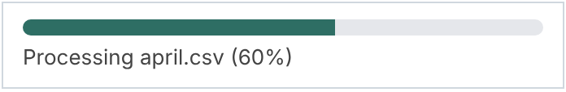
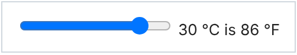
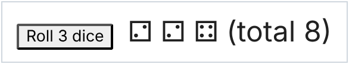

<!-- Generated by scripts/reference.ts from the doc comments in runtime/widget.d.mts, runtime/comm.d.mts. Edit those, then run `node scripts/reference.ts --write`. -->

# Widgets and comms reference

The widget model that `jupyter.widget(options)` returns, and the comm
API under `jupyter.comm`, with their arguments, return values and an
example. [Widgets and comms](widgets.md) explains them with a full
walk-through, including the view module.

| Member | What it does |
| --- | --- |
| [`widget.get(key)`](#widget-get) | The current value of a state key. |
| [`widget.set(key, value)`](#widget-set) | Change one state key, or several at once, and sync the change to every view. |
| [`widget.on(event, listener)`](#widget-on) | Listen for state changes or custom messages from the views. |
| [`widget.off(event, listener)`](#widget-off) | Remove a listener added with `on`. |
| [`widget.send(content, buffers?)`](#widget-send) | Send a custom message to every view's `model.on("msg:custom", ...)`. |
| [`widget.close()`](#widget-close) | Close the model. |
| [`widget.fullState()`](#widget-fullstate) | The full state, as the frontend sees it. |
| [`jupyter.comm.open(targetName, data?, options?)`](#jupyter-comm-open) | Open a comm to a target the frontend registered. |
| [`jupyter.comm.registerTarget(targetName, handler)`](#jupyter-comm-registertarget) | Accept comms the frontend opens on `targetName`. |
| [`jupyter.comm.unregisterTarget(targetName)`](#jupyter-comm-unregistertarget) | Stop accepting new comms on `targetName`. |
| [`comm.send(data?, options?)`](#comm-send) | Send a message to the frontend's end. |
| [`comm.close(data?, options?)`](#comm-close) | Close the comm and tell the frontend. |
| [`comm.onMsg(handler)`](#comm-onmsg) | Handle messages from the frontend's end. |
| [`comm.onClose(handler)`](#comm-onclose) | Handle the comm closing, from either end. |

<a id="widget-model"></a>

## Widget model

An anywidget model, from `jupyter.widget`, synced with its frontend
views. Display it to show a view; display it again for a second view of
the same model.

`jupyter.widget(options)` returns it; see the [`jupyter` reference](jupyter-reference.md#jupyter-widget).

<a id="widget-get"></a>

### `widget.get(key)`

```ts
get(key: string): unknown;
```

The current value of a state key.

| Parameter | Type | Required | Description |
| --- | --- | --- | --- |
| `key` | `string` | yes | The state key. |

**Returns** `unknown`: Its value, or `undefined`.

```ts
const w = jupyter.widget({ esm: "export default {}", state: { count: 0 } });
w.get("count"); // 0
```

<a id="widget-set"></a>

### `widget.set(key, value)`

```ts
set(key: string, value: unknown): void;
set(changes: WidgetState): void;
```

Change one state key, or several at once, and sync the change to every
view. Fires this model's own `change` listeners too. After `close` it
changes the local state only.

| Parameter | Type | Required | Description |
| --- | --- | --- | --- |
| `key` | `string` | no | The state key. |
| `value` | `unknown` | no | Its new value. |
| `changes` | `WidgetState` | no | Several keys and their new values, instead of `key` and `value`. |

```ts
const w = jupyter.widget({ esm: "export default {}", state: { count: 0, label: "" } });
w.set("count", 1);
w.set({ count: 2, label: "two" });
```

```ts
const progress = jupyter.widget({
  esm: `export default {
    render({ model, el }) {
      el.innerHTML =
        '<div class="progress-track"><div class="progress-fill"></div></div>' +
        '<div class="progress-label"></div>';
      const fill = el.querySelector(".progress-fill");
      const label = el.querySelector(".progress-label");
      const update = () => {
        const percent = Math.round(model.get("value") * 100);
        fill.style.width = percent + "%";
        label.textContent = model.get("message") + " (" + percent + "%)";
      };
      model.on("change:value", update);
      model.on("change:message", update);
      update();
    },
  };`,
  css: `
    .progress-track { width: 320px; height: 10px; border-radius: 5px; background: #e5e7eb; overflow: hidden; }
    .progress-fill { height: 100%; background: #2e6e64; transition: width 0.2s; }
    .progress-label { margin-top: 6px; font: 13px system-ui, sans-serif; color: #444; }
  `,
  state: { value: 0, message: "Starting" },
});
await jupyter.display(progress);

const files = ["january.csv", "february.csv", "march.csv", "april.csv", "may.csv"];
for (const [i, file] of files.entries()) {
  progress.set({ message: "Processing " + file, value: i / files.length });
  await new Promise((resolve) => setTimeout(resolve, 600)); // stand-in for real work
}
progress.set({ message: "Done", value: 1 });
```



<a id="widget-on"></a>

### `widget.on(event, listener)`

```ts
on(event: `change:${string}`, listener: (value: unknown, previous: unknown) => void | Promise<void>): void;
on(event: "change", listener: (changes: WidgetState) => void | Promise<void>): void;
on(event: "msg:custom", listener: (content: unknown, buffers: Uint8Array[]) => void | Promise<void>): void;
```

Listen for state changes or custom messages from the views.
`change:key` gets the new and previous value; `change` gets all the
changed keys; `msg:custom` gets a view's `model.send` content.

| Parameter | Type | Required | Description |
| --- | --- | --- | --- |
| `event` | ``change:${string}`` | yes | `change:<key>`, `change` or `msg:custom`. |
| `listener` | `(value: unknown, previous: unknown) => void \| Promise<void>` | yes | Called for each event; may be async. |

```ts
const w = jupyter.widget({ esm: "export default {}", state: { count: 0 } });
w.on("change:count", (value, previous) => console.log(previous, "->", value));
w.on("msg:custom", (content) => console.log("view sent", content));
```

```ts
const temperature = jupyter.widget({
  esm: `export default {
    render({ model, el }) {
      const slider = document.createElement("input");
      slider.type = "range";
      slider.min = "-20";
      slider.max = "40";
      const label = document.createElement("span");
      const update = () => {
        slider.value = String(model.get("celsius"));
        label.textContent = " " + model.get("celsius") + " °C is " + model.get("fahrenheit") + " °F";
      };
      slider.oninput = () => {
        model.set("celsius", slider.valueAsNumber);
        model.save_changes();
      };
      model.on("change:celsius", update);
      model.on("change:fahrenheit", update);
      update();
      el.append(slider, label);
    },
  };`,
  state: { celsius: 20, fahrenheit: 68 },
});

temperature.on("change:celsius", (celsius) => {
  temperature.set("fahrenheit", Math.round((Number(celsius) * 9) / 5 + 32));
});

temperature;
```



<a id="widget-off"></a>

### `widget.off(event, listener)`

```ts
off(event: string, listener: (...args: never[]) => unknown): void;
```

Remove a listener added with `on`.

| Parameter | Type | Required | Description |
| --- | --- | --- | --- |
| `event` | `string` | yes | The event it was added for. |
| `listener` | `(...args: never[]) => unknown` | yes | The same function. |

```ts
const w = jupyter.widget({ esm: "export default {}", state: { count: 0 } });
const log = (value: unknown) => console.log(value);
w.on("change:count", log);
w.off("change:count", log);
```

<a id="widget-send"></a>

### `widget.send(content, buffers?)`

```ts
send(content: unknown, buffers?: Uint8Array[]): void;
```

Send a custom message to every view's `model.on("msg:custom", ...)`.

| Parameter | Type | Required | Description |
| --- | --- | --- | --- |
| `content` | `unknown` | yes | JSON content. |
| `buffers` | `Uint8Array[]` | no | Binary buffers. Default `[]`. |

```ts
const w = jupyter.widget({ esm: "export default {}" });
w.send({ type: "reset" });
```

```ts
const dice = jupyter.widget({
  esm: `export default {
    render({ model, el }) {
      const button = document.createElement("button");
      button.textContent = "Roll 3 dice";
      button.onclick = () => model.send({ count: 3 });
      const result = document.createElement("span");
      result.style.marginLeft = "12px";
      result.style.fontSize = "24px";
      model.on("msg:custom", (message) => {
        result.textContent = message.faces + "  (total " + message.total + ")";
      });
      el.append(button, result);
    },
  };`,
});

dice.on("msg:custom", (content) => {
  const { count } = content as { count: number };
  const rolls = Array.from({ length: count }, () => 1 + Math.floor(Math.random() * 6));
  dice.send({
    faces: rolls.map((n) => "⚀⚁⚂⚃⚄⚅"[n - 1]).join(" "),
    total: rolls.reduce((a, b) => a + b, 0),
  });
});

dice;
```



<a id="widget-close"></a>

### `widget.close()`

```ts
close(): void;
```

Close the model. Its views stop syncing.

```ts
const w = jupyter.widget({ esm: "export default {}" });
w.close();
```

<a id="widget-fullstate"></a>

### `widget.fullState()`

```ts
fullState(): WidgetState;
```

The full state, as the frontend sees it.

**Returns** `WidgetState`: Every state key and its value.

```ts
const w = jupyter.widget({ esm: "export default {}", state: { count: 0 } });
w.fullState(); // { count: 0 }
```

### Properties

| Property | Type | Description |
| --- | --- | --- |
| `id` | `string` | The model id (the comm id). |
| `closed` | `boolean` | Whether the model has been closed. |

<a id="jupyter-comm"></a>

## `jupyter.comm`

`jupyter.comm`: open comms, and accept comms the frontend opens.

<a id="jupyter-comm-open"></a>

### `jupyter.comm.open(targetName, data?, options?)`

```ts
open(targetName: string, data?: { [key: string]: unknown }, options?: CommSendOptions): Comm;
```

Open a comm to a target the frontend registered.

| Parameter | Type | Required | Description |
| --- | --- | --- | --- |
| `targetName` | `string` | yes | The frontend's target name. |
| `data` | `{ [key: string]: unknown }` | no | Data sent with the open message. Default `{}`. |
| `options` | `CommSendOptions` | no | Metadata and binary buffers. |

**Returns** `Comm`: The kernel's end of the comm.

```ts
const comm = jupyter.comm.open("my.target", { hello: 1 });
comm.onMsg((m) => console.log(m.data));
```

<a id="jupyter-comm-registertarget"></a>

### `jupyter.comm.registerTarget(targetName, handler)`

```ts
registerTarget(targetName: string, handler: (comm: Comm, msg: CommMessage) => void | Promise<void>): void;
```

Accept comms the frontend opens on `targetName`. Registering the same
name again replaces the handler.

| Parameter | Type | Required | Description |
| --- | --- | --- | --- |
| `targetName` | `string` | yes | The target name the frontend opens comms on. |
| `handler` | `(comm: Comm, msg: CommMessage) => void \| Promise<void>` | yes | Called with the new comm and its open message. |

```ts
jupyter.comm.registerTarget("echo", (comm) => comm.onMsg((m) => comm.send(m.data)));
```

<a id="jupyter-comm-unregistertarget"></a>

### `jupyter.comm.unregisterTarget(targetName)`

```ts
unregisterTarget(targetName: string): void;
```

Stop accepting new comms on `targetName`. Comms already open stay open.

| Parameter | Type | Required | Description |
| --- | --- | --- | --- |
| `targetName` | `string` | yes | The target to remove. |

```ts
jupyter.comm.unregisterTarget("echo");
```

<a id="comm"></a>

## `Comm`

One end of a Jupyter comm channel, from `jupyter.comm.open` or a target handler.

<a id="comm-send"></a>

### `comm.send(data?, options?)`

```ts
send(data?: { [key: string]: unknown }, options?: CommSendOptions): void;
```

Send a message to the frontend's end. Does nothing once closed.

| Parameter | Type | Required | Description |
| --- | --- | --- | --- |
| `data` | `{ [key: string]: unknown }` | no | The message's JSON data. Default `{}`. |
| `options` | `CommSendOptions` | no | Metadata and binary buffers. |

```ts
const comm = jupyter.comm.open("my.target");
comm.send({ ping: true }, { buffers: [new Uint8Array([1, 2, 3])] });
```

<a id="comm-close"></a>

### `comm.close(data?, options?)`

```ts
close(data?: { [key: string]: unknown }, options?: CommSendOptions): void;
```

Close the comm and tell the frontend. Its `onClose` handlers run
afterwards, without being awaited. Does nothing once closed.

| Parameter | Type | Required | Description |
| --- | --- | --- | --- |
| `data` | `{ [key: string]: unknown }` | no | Data sent with the close message. Default `{}`. |
| `options` | `CommSendOptions` | no | Metadata and binary buffers. |

```ts
const comm = jupyter.comm.open("my.target");
comm.close({ reason: "done" });
```

<a id="comm-onmsg"></a>

### `comm.onMsg(handler)`

```ts
onMsg(handler: (msg: CommMessage) => void | Promise<void>): void;
```

Handle messages from the frontend's end. A handler runs like a cell:
its output goes to the notebook, and an exception shows on stderr.

| Parameter | Type | Required | Description |
| --- | --- | --- | --- |
| `handler` | `(msg: CommMessage) => void \| Promise<void>` | yes | Called with each message; may be async. |

```ts
const comm = jupyter.comm.open("my.target");
comm.onMsg(({ data, buffers }) => console.log(data, buffers.length));
```

<a id="comm-onclose"></a>

### `comm.onClose(handler)`

```ts
onClose(handler: (msg: CommMessage) => void | Promise<void>): void;
```

Handle the comm closing, from either end.

| Parameter | Type | Required | Description |
| --- | --- | --- | --- |
| `handler` | `(msg: CommMessage) => void \| Promise<void>` | yes | Called with the close message; may be async. |

```ts
const comm = jupyter.comm.open("my.target");
comm.onClose(() => console.log("closed"));
```

### Properties

| Property | Type | Description |
| --- | --- | --- |
| `id` | `string` | The comm id, shared with the frontend's end. |
| `targetName` | `string` | The target the comm was opened on. |
| `closed` | `boolean` | Whether either end has closed the comm. |

## Types

<a id="widgetoptions"></a>

### `WidgetOptions`

Options for `jupyter.widget`.

| Property | Type | Required | Description |
| --- | --- | --- | --- |
| `esm` | `string` | yes | The anywidget view module, as source: `export default { render({ model, el }) { ... } }`. A `${...}` inside a template literal here is filled in by the kernel, not the browser: escape it as `\${...}`. |
| `css` | `string` | no | CSS for the view. |
| `state` | `WidgetState` | no | The initial synced state. `Uint8Array` and `ArrayBuffer` values travel as binary buffers. Default `{}`. |

<a id="commmessage"></a>

### `CommMessage`

A comm message as a handler receives it.

| Property | Type | Required | Description |
| --- | --- | --- | --- |
| `data` | `{ [key: string]: unknown }` | yes | The message's JSON data. |
| `metadata` | `{ [key: string]: unknown }` | yes | The message's metadata. |
| `buffers` | `Uint8Array[]` | yes | Binary buffers sent with the message. |

<a id="commsendoptions"></a>

### `CommSendOptions`

Options for sending, opening or closing a comm.

| Property | Type | Required | Description |
| --- | --- | --- | --- |
| `metadata` | `{ [key: string]: unknown }` | no | Metadata for the message. Default `{}`. |
| `buffers` | `Uint8Array[]` | no | Binary buffers sent with the message. Default `[]`. |
