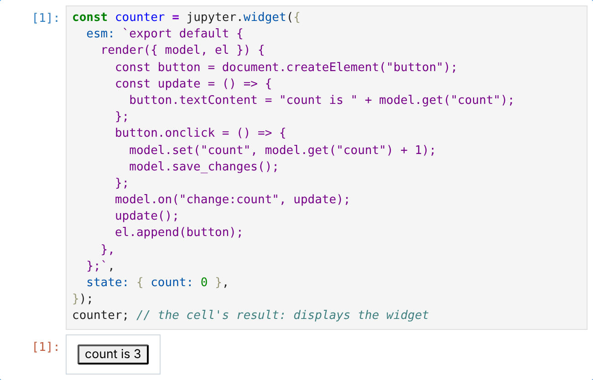
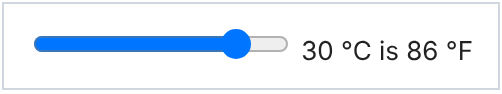
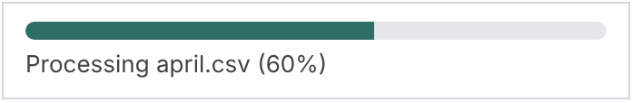
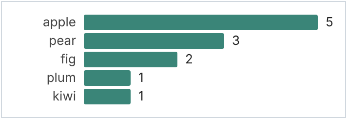
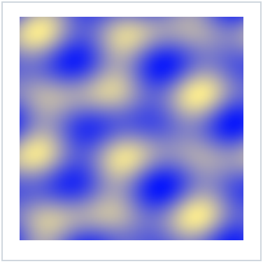
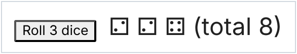
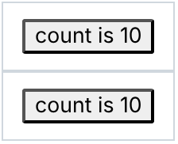

<!-- The examples marked widget-example below are run in JupyterLab, and the
screenshots in images/widgets/ captured, by `npm run docs:widgets`. -->

# Widgets and comms

A **widget** is a small piece of user interface (a button, a slider, a
chart, a canvas) that lives in a cell's output and stays connected to the
kernel. Click the button and code in the kernel can react; change a value
in the kernel and the button updates. Ordinary output is a one-way
snapshot; a widget is live.



`deno jupyter` has no widgets. cdp-kernel supports them on every runtime
(Node, Deno, Bun, workerd and celld) through `jupyter.widget`, which
follows the [anywidget](https://anywidget.dev) format: you write the view
as a small JavaScript module, and the kernel and the frontend keep a shared
state object in sync.

This page assumes no experience with Jupyter widgets. Every example below
was run in JupyterLab against the kernel on Node, Deno, Bun and workerd,
and each picture is a screenshot of the Node run.

## Before you start

Widgets are drawn by the frontend, so the frontend needs the `anywidget`
extension. It works in JupyterLab, Jupyter Notebook 7 and VS Code. Install
it into the same Python environment as Jupyter:

```sh
pip install anywidget
```

That is the whole frontend setup: anywidget is a Python package, but no
Python kernel is involved. If the extension is missing, a widget shows up
as plain text such as `Widget(4f9c…)`; see
[Troubleshooting](#troubleshooting).

Python users may know the ready-made ipywidgets controls (`IntSlider`,
`Dropdown` and so on). Those are Python classes and aren't available here.
You build controls from plain HTML instead, as the examples show; most take
a dozen lines.

## How a widget works

A widget has two halves:

- The **model** lives in the kernel. `jupyter.widget()` creates it and
  returns an object with `get`, `set` and `on`. Its state is a plain object
  of JSON values (and binary data).
- The **view** is the JavaScript module you pass as `esm`. The frontend
  runs it in the browser and calls its `render({ model, el })` function
  with a browser-side copy of the model and an empty element `el` to draw
  into.

When either side changes a key, the change is sent to the other side and
to every other view of the same model. Each side listens for changes with
`on("change:key", ...)`.

## A first widget: a counter

```ts
const counter = jupyter.widget({
  esm: `export default {
    render({ model, el }) {
      const button = document.createElement("button");
      const update = () => {
        button.textContent = "count is " + model.get("count");
      };
      button.onclick = () => {
        model.set("count", model.get("count") + 1);
        model.save_changes();
      };
      model.on("change:count", update);
      update();
      el.append(button);
    },
  };`,
  state: { count: 0 },
});
counter; // the cell's result: displays the widget
```

<!-- widget-example: counter -->

Reading the view module from top to bottom:

1. `render` gets the model and an element. It builds a `<button>` and
   appends it to `el`.
2. `update` copies the model's `count` into the button's label. It runs
   once at the start and again whenever `count` changes.
3. A click calls `model.set` to change the browser's copy, then
   `model.save_changes()` to send it to the kernel. Without
   `save_changes()` the kernel never hears about it.

Click the button three times, then ask the kernel:

```ts
counter.get("count"); // 3
```

<!-- widget-example: counter-get -->

And set it from the kernel; the button follows:

```ts
counter.set("count", 10);
```

<!-- widget-example: counter-set -->

The view module is a string, written here as a template literal. The
examples on this page build their text with `+` rather than nested
`${...}`, which would need escaping inside the outer template literal. See
[Keeping the view in a file](#keeping-the-view-in-a-file) for a way to
avoid the string altogether.

## The kernel reacts to the view

Here a slider in the view sets `celsius`, and a listener in the kernel
computes `fahrenheit` and sets it back. The view only displays what the
kernel sends, so any logic you can write in a cell can sit behind a
control.

```ts
const temperature = jupyter.widget({
  esm: `export default {
    render({ model, el }) {
      const slider = document.createElement("input");
      slider.type = "range";
      slider.min = "-20";
      slider.max = "40";
      const label = document.createElement("span");
      const update = () => {
        slider.value = String(model.get("celsius"));
        label.textContent = " " + model.get("celsius") + " °C is " + model.get("fahrenheit") + " °F";
      };
      slider.oninput = () => {
        model.set("celsius", slider.valueAsNumber);
        model.save_changes();
      };
      model.on("change:celsius", update);
      model.on("change:fahrenheit", update);
      update();
      el.append(slider, label);
    },
  };`,
  state: { celsius: 20, fahrenheit: 68 },
});

temperature.on("change:celsius", (celsius) => {
  temperature.set("fahrenheit", Math.round((Number(celsius) * 9) / 5 + 32));
});

temperature;
```

<!-- widget-example: temperature -->



A kernel listener gets the new value and the previous one:
`on("change:celsius", (value, previous) => ...)`. To hear about every key,
use `on("change", (changes) => ...)`, which gets an object of the keys that
changed.

Listeners run like cells, one at a time and in between cell executions.
While a cell is running, a slider move waits until the cell finishes.
`console.log` output from a listener isn't shown under any cell (JupyterLab
puts it in its log console), so show results through the widget's state,
as here.

## The kernel updates the view while a cell runs

`set` from the kernel goes out immediately, even in the middle of a long
cell, so a widget makes a good progress indicator. This one also passes
`css`, a stylesheet for the view.

```ts
const progress = jupyter.widget({
  esm: `export default {
    render({ model, el }) {
      el.innerHTML =
        '<div class="progress-track"><div class="progress-fill"></div></div>' +
        '<div class="progress-label"></div>';
      const fill = el.querySelector(".progress-fill");
      const label = el.querySelector(".progress-label");
      const update = () => {
        const percent = Math.round(model.get("value") * 100);
        fill.style.width = percent + "%";
        label.textContent = model.get("message") + " (" + percent + "%)";
      };
      model.on("change:value", update);
      model.on("change:message", update);
      update();
    },
  };`,
  css: `
    .progress-track { width: 320px; height: 10px; border-radius: 5px; background: #e5e7eb; overflow: hidden; }
    .progress-fill { height: 100%; background: #2e6e64; transition: width 0.2s; }
    .progress-label { margin-top: 6px; font: 13px system-ui, sans-serif; color: #444; }
  `,
  state: { value: 0, message: "Starting" },
});
await jupyter.display(progress);

const files = ["january.csv", "february.csv", "march.csv", "april.csv", "may.csv"];
for (const [i, file] of files.entries()) {
  progress.set({ message: "Processing " + file, value: i / files.length });
  await new Promise((resolve) => setTimeout(resolve, 600)); // stand-in for real work
}
progress.set({ message: "Done", value: 1 });
```

<!-- widget-example: progress -->



`await jupyter.display(progress)` shows the widget straight away, rather
than as the cell's result at the end. `set({ ... })` changes several keys
in one message.

The `css` string is added to the whole page, not just this widget, so give
classes a prefix (`progress-` here) that won't collide with JupyterLab's own
or another widget's.

## Sending data to the view

State can hold any JSON value, such as an array of records. This bar chart
redraws whenever the kernel sets `data`, so the same widget can show the
result of each new computation.

```ts
const chart = jupyter.widget({
  esm: `export default {
    render({ model, el }) {
      const draw = () => {
        const data = model.get("data");
        const max = Math.max(...data.map((d) => d.value));
        el.replaceChildren();
        for (const d of data) {
          const row = document.createElement("div");
          row.className = "chart-row";
          const label = document.createElement("span");
          label.className = "chart-label";
          label.textContent = d.label;
          const bar = document.createElement("span");
          bar.className = "chart-bar";
          bar.style.width = (d.value / max) * 240 + "px";
          const value = document.createElement("span");
          value.textContent = d.value;
          row.append(label, bar, value);
          el.append(row);
        }
      };
      model.on("change:data", draw);
      draw();
    },
  };`,
  css: `
    .chart-row { display: flex; align-items: center; gap: 8px; margin: 3px 0; font: 13px system-ui, sans-serif; }
    .chart-label { width: 64px; text-align: right; color: #444; }
    .chart-bar { height: 16px; background: #3a8578; border-radius: 2px; }
  `,
  state: { data: [] },
});

const votes = "apple pear apple fig plum apple pear fig apple kiwi pear apple".split(" ");
const counts = new Map<string, number>();
for (const vote of votes) counts.set(vote, (counts.get(vote) ?? 0) + 1);
chart.set(
  "data",
  [...counts].sort((a, b) => b[1] - a[1]).map(([label, value]) => ({ label, value })),
);
chart;
```

<!-- widget-example: chart -->



Run `chart.set("data", ...)` again in a later cell and the chart redraws in
place.

## Binary data

`Uint8Array`, `ArrayBuffer`, `DataView` and other typed arrays in the state
travel as raw binary rather than JSON, so large numeric data stays compact.
In the view, a binary value arrives as a `DataView`.

This example computes an image's pixels in the kernel and draws them on a
`<canvas>`:

```ts
const size = 160;

function pattern(t: number): Uint8Array {
  const pixels = new Uint8Array(size * size * 4); // red, green, blue, alpha
  for (let y = 0; y < size; y++) {
    for (let x = 0; x < size; x++) {
      const v = Math.sin(x / 9 + t) + Math.sin(y / 7) + Math.sin((x + y) / 13 - t);
      const i = (y * size + x) * 4;
      pixels[i] = 128 + 40 * v;
      pixels[i + 1] = 128 + 35 * v;
      pixels[i + 2] = 200 - 18 * v;
      pixels[i + 3] = 255;
    }
  }
  return pixels;
}

const canvas = jupyter.widget({
  esm: `export default {
    render({ model, el }) {
      const size = model.get("size");
      const canvas = document.createElement("canvas");
      canvas.width = canvas.height = size;
      const context = canvas.getContext("2d");
      const draw = () => {
        const bytes = model.get("pixels"); // a DataView
        const rgba = new Uint8ClampedArray(bytes.buffer, bytes.byteOffset, bytes.byteLength);
        context.putImageData(new ImageData(rgba, size, size), 0, 0);
      };
      model.on("change:pixels", draw);
      draw();
      el.append(canvas);
    },
  };`,
  state: { size, pixels: pattern(0) },
});
canvas;
```

<!-- widget-example: canvas -->



Setting new pixels from the kernel animates it:

```ts
for (let t = 0; t < 6; t += 0.1) {
  canvas.set("pixels", pattern(t));
  await new Promise((resolve) => setTimeout(resolve, 30));
}
```

<!-- widget-example: canvas-animate -->

## Messages instead of state

State is for values that should persist and that every view shares. For
one-off requests, such as "do this now", send a custom message instead. In
the view, `model.send(content)` goes to the kernel's `on("msg:custom")`;
in the kernel, `widget.send(content)` goes to the view's
`model.on("msg:custom")`.

```ts
const dice = jupyter.widget({
  esm: `export default {
    render({ model, el }) {
      const button = document.createElement("button");
      button.textContent = "Roll 3 dice";
      button.onclick = () => model.send({ count: 3 });
      const result = document.createElement("span");
      result.style.marginLeft = "12px";
      result.style.fontSize = "24px";
      model.on("msg:custom", (message) => {
        result.textContent = message.faces + "  (total " + message.total + ")";
      });
      el.append(button, result);
    },
  };`,
});

dice.on("msg:custom", (content) => {
  const { count } = content as { count: number };
  const rolls = Array.from({ length: count }, () => 1 + Math.floor(Math.random() * 6));
  dice.send({
    faces: rolls.map((n) => "⚀⚁⚂⚃⚄⚅"[n - 1]).join(" "),
    total: rolls.reduce((a, b) => a + b, 0),
  });
});

dice;
```

<!-- widget-example: dice -->



Both directions of `send` take an optional list of binary buffers as a
second argument.

## One model, several views

Displaying the same widget twice gives two views of one model. A change in
either view, or from the kernel, shows in both:

```ts
await jupyter.display(counter);
await jupyter.display(counter);
```

<!-- widget-example: views -->



Here both read 10 because of the earlier `counter.set("count", 10)`.
Clicking either one updates the other, and the original view higher up in
the notebook.

## Writing the view module

The view module follows anywidget's format. `render({ model, el })` is
called once per view. In the view:

| Call | What it does |
| --- | --- |
| `model.get(key)` | The current value. |
| `model.set(key, value)` | Changes the browser's copy. |
| `model.save_changes()` | Sends the changes made with `set` to the kernel and the other views. |
| `model.on("change:key", fn)` | Calls `fn` when `key` changes, from either side. |
| `model.on("msg:custom", fn)` | Calls `fn(content, buffers)` for each message from the kernel's `send`. |
| `model.send(content, callbacks?, buffers?)` | Sends a message to the kernel's `on("msg:custom")`. |

`render` may return a function, which is called when the view is removed;
use it to clear timers or listeners you added outside `el`. The module can
`import` from a URL, such as a CDN build of a charting library, as long as
the browser running the frontend can reach it. anywidget's
[documentation](https://anywidget.dev/en/afm/) describes the format in
full.

### Keeping the view in a file

For anything longer than a few lines, keep the view in its own `.js` file,
where your editor highlights and checks it, and read it into the cell. On
Node, Deno and Bun:

```ts
import { readFile } from "node:fs/promises";

const fancy = jupyter.widget({
  esm: await readFile("./fancy-widget.js", "utf8"),
  state: { count: 0 },
});
```

workerd and celld have no file system, so there the module has to be a
string in the notebook.

## The kernel's widget API

`jupyter.widget({ esm, css?, state? })` creates a model and returns it. The
model has:

| Member | What it does |
| --- | --- |
| `get(key)` | The current value of `key`. |
| `set(key, value)`, `set({ ... })` | Changes one key or several, and sends the change to every view. |
| `on("change:key", (value, previous) => ...)` | A view changed `key`. Also fires for the kernel's own `set`. |
| `on("change", (changes) => ...)` | Any keys changed; `changes` holds the new values. |
| `on("msg:custom", (content, buffers) => ...)` | A message from a view's `model.send`. |
| `off(event, listener)` | Removes a listener. |
| `send(content, buffers?)` | A message to every view's `model.on("msg:custom")`. |
| `close()` | Closes the model. Its views stop syncing. |
| `id`, `closed` | The model id, and whether it has been closed. |

A model stays alive while the kernel runs. JupyterLab restores widget views
after a page reload by asking the kernel for every model's state; after a
kernel restart, re-run the cells that create them.

## Troubleshooting

- **The output is text like `Widget(4f9c…)` instead of a widget.** The
  frontend doesn't have the anywidget extension. Install it with
  `pip install anywidget` in the environment Jupyter runs from, then reload
  the page.
- **The widget area is empty.** The view module threw an error. Open the
  browser's developer console (in VS Code, "Developer: Toggle Developer
  Tools") to see it. A common cause is a `${...}` inside the `esm` template
  literal, which the kernel fills in before the browser sees the module.
- **Clicks don't reach the kernel.** Check that the view calls
  `model.save_changes()` after `model.set`. Also, a running cell delays
  widget events until it finishes.

## Comms

Widgets are built on **comms**, Jupyter's channels for messages between the
kernel and the frontend outside cell execution. The comm layer is available
directly, for other comm-based protocols:

```ts
const comm = jupyter.comm.open("my.target", { hello: 1 });
comm.onMsg(({ data, buffers }) => console.log(data, buffers.length));
comm.send({ ping: true });
jupyter.comm.registerTarget("echo", (comm) => comm.onMsg((m) => comm.send(m.data)));
```

Comm handlers run like cells. Their output goes to the notebook as replies
to the message that triggered them, an exception is shown on stderr, and
interrupt stops a stuck handler. Messages are processed one at a time with
cell executions, as in ipykernel, so a widget event that arrives during a
long cell waits for the cell to finish.
